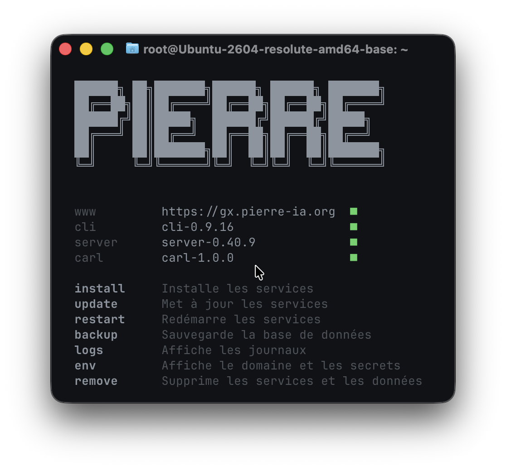

# Héberger & déployer PIERRE

## Faire héberger PIERRE (le plus simple)

Si vous ne souhaitez pas gérer l'infrastructure, le projet PIERRE propose une **offre d'hébergement managé** :

- Déploiement et paramétrage clé en main sur serveur dédié
- Mises à jour automatiques (dernière version en permanence)
- Suivi et monitoring inclus
- Hébergement chez l'hébergeur de votre choix
- Aucune compétence technique requise côté bailleur

Adresser un email à charnould@pierre-ia.org pour en savoir plus.

## Héberger PIERRE (self-hosting)

### Prérequis

Avant de déployer PIERRE, vérifier que vous disposez de :

| Prérequis         | Détail                                                             |
| ----------------- | ------------------------------------------------------------------ |
| **Serveur**       | Ubuntu ou Debian, `x86_64`, avec `/dev/kvm`                        |
| **Ports ouverts** | `80` (HTTP) et `443` (HTTPS)                                       |
| **Accès SSH**     | Clef ou mot de passe, en root                                      |
| **DNS**           | Le DNS du nom choisi doit pointer vers le serveur, **sans proxy**. |

>

> [!IMPORTANT]
> Recommandation de serveur : `/dev/kvm` est la seule contrainte matérielle **(nul besoin de GPU)**. Nous recommandons un serveur d'une configuration équivalente ou supérieure à [EX44](https://www.hetzner.com/dedicated-rootserver/ex44) (minimum 64 GB de RAM). Une seule instance de PIERRE est déployable par serveur.

### Déployer PIERRE sur un serveur (15 minutes)



#### Étape 1

Choisir le domaine ou sous-domaine qui sera utilisé pour accéder à PIERRE.  
Exemple : `pierre.actionlogement.fr`, `ia.rivp.fr`, etc.

Ce domaine a un double usage :

- les collaborateurs de votre organisme devront saisir `https://ia.rivp.fr` en plus de leur identifiant et mot de passe lors de leur connexion à l'application Desktop.
- Si vous décidez de proposer un chatbot à vos locataires, celui-ci sera accessible à cette même URL.

#### Étape 2

Chez votre registrar, dans vos `DNS`, créer un enregistrement `A` faisant pointer votre choix de l'étape 1 ver l'`IP` de votre serveur. Pas de redirection, pas de proxy.

#### Étape 3

Connecté sur le serveur en root, saisissez cette commande pour installer le `CLI` :

```bash
curl -fsSL https://github.com/charnould/pierre/releases/download/cli-0.9.16/install.sh | sh
```

> Certains hébergeurs n'ouvrent pas le `22` : `ssh` prend alors `-p` et `scp` prend `-P`, par exemple `ssh -p 2234 root@le-serveur`.

#### Étape 4

Saisissez la commande suivante pour installer les services nécessaires. Remplacer `ia.rivp.fr` par le domaine choisi à l'étape 1.

```bash
pierre install --host ia.rivp.fr
```

PIERRE génère le mot de passe administrateur, conservez-le, vous en aurez besoin pour paramétrer l'application Desktop.

#### Étape 5

C'est tout. Vérifiez que tout est au vert avec :

```bash
pierre
```

### Commandes disponibles

```bash
pierre
```

| Commande                        | Effet                                 |
| ------------------------------- | ------------------------------------- |
| `pierre`                        | Affiche l'état et les commandes.      |
| `pierre install --host DOMAINE` | Installe les services.                |
| `pierre update`                 | Met à jour les services.              |
| `pierre restart`                | Redémarre les services.               |
| `pierre backup`                 | Sauvegarde la base de données.        |
| `pierre logs`                   | Affiche les journaux.                 |
| `pierre env`                    | Affiche le domaine et les secrets.    |
| `pierre remove`                 | Supprime les services et les données. |

> Toutes les données de PIERRE sont regroupées sous `/var/lib/pierre`.
