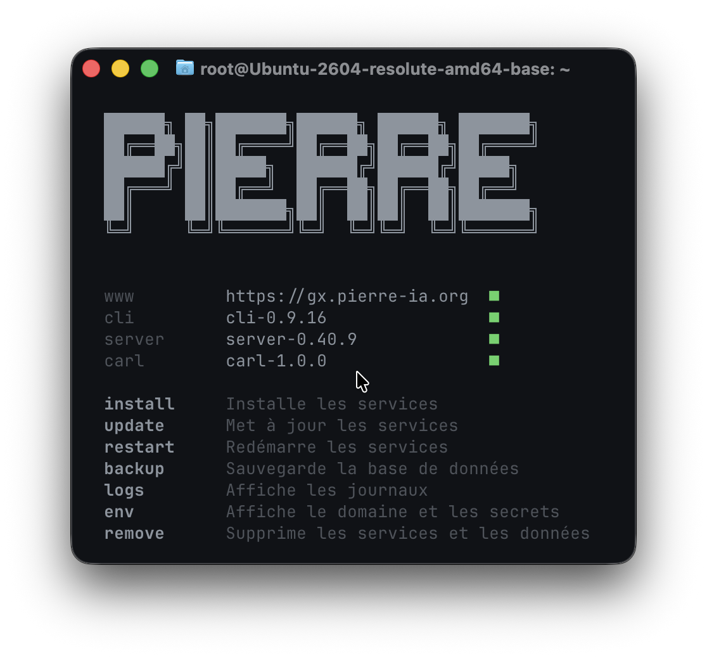

# Héberger & déployer PIERRE

## Faire héberger PIERRE (le plus simple)

Si vous ne souhaitez pas gérer l'infrastructure, le projet PIERRE propose une **offre d'hébergement managé** :

- Déploiement et paramétrage clé en main sur serveur dédié
- Mises à jour automatiques (dernière version en permanence)
- Suivi et monitoring inclus
- Hébergement chez l'hébergeur de votre choix
- Aucune compétence technique requise côté bailleur

Adresser un email à charnould@pierre-ia.org pour en savoir plus.

## Héberger PIERRE (self-hosting)

### Prérequis

Avant de déployer PIERRE, vérifier que vous disposez de :

| Prérequis         | Détail                                                             |
| ----------------- | ------------------------------------------------------------------ |
| **Serveur**       | Ubuntu ou Debian, `x86_64`, avec `/dev/kvm`                        |
| **Ports ouverts** | `80` (HTTP) et `443` (HTTPS)                                       |
| **Accès SSH**     | Clef ou mot de passe, en root                                      |
| **DNS**           | Le DNS du nom choisi doit pointer vers le serveur, **sans proxy**. |

>

> [!IMPORTANT]
> Recommandation de serveur : `/dev/kvm` est la seule contrainte matérielle **(nul besoin de GPU)**. Nous recommandons un serveur d'une configuration équivalente ou supérieure à [EX44](https://www.hetzner.com/dedicated-rootserver/ex44) (minimum 64 GB de RAM). Une seule instance de PIERRE est déployable par serveur.

### Déployer PIERRE sur un serveur (15 minutes)



#### Étape 1

Choisir le domaine ou sous-domaine qui sera utilisé pour accéder à PIERRE.  
Exemple : `pierre.actionlogement.fr`, `ia.rivp.fr`, etc.

Ce domaine a un double usage :

- les collaborateurs de votre organisme devront saisir `https://ia.rivp.fr` en plus de leur identifiant et mot de passe lors de leur connexion à l'application Desktop.
- Si vous décidez de proposer un chatbot à vos locataires, celui-ci sera accessible à cette même URL.

#### Étape 2

Chez votre registrar, dans vos `DNS`, créer un enregistrement `A` faisant pointer votre choix de l'étape 1 ver l'`IP` de votre serveur. Pas de redirection, pas de proxy.

#### Étape 3

Connecté sur le serveur en root, saisissez cette commande pour installer le `CLI` :

```bash
curl -fsSL https://github.com/charnould/pierre/releases/download/cli-0.9.25/install.sh | sh
```

> Certains hébergeurs n'ouvrent pas le `22` : `ssh` prend alors `-p` et `scp` prend `-P`, par exemple `ssh -p 2234 root@le-serveur`.

#### Étape 4

Saisissez la commande suivante pour installer les services nécessaires. Remplacer `ia.rivp.fr` par le domaine choisi à l'étape 1.

```bash
pierre install --host ia.rivp.fr
```

Le processus peut prendre plusieurs minutes. Le laisser se terminer jusqu'à ce qu'il génère et affiche le mot de passe administrateur, conservez-le, vous en aurez besoin pour paramétrer l'application Desktop.

#### Étape 5

C'est tout. Vérifiez que tout est au vert avec :

```bash
pierre
```

### Commandes disponibles

```bash
pierre
```

| Commande                        | Effet                                        |
| ------------------------------- | -------------------------------------------- |
| `pierre`                        | Affiche l'état et les commandes.             |
| `pierre install --host DOMAINE` | Installe les services.                       |
| `pierre update`                 | Met à jour les services.                     |
| `pierre restart`                | Redémarre les services.                      |
| `pierre backup`                 | Écrit une copie datée de `datastore.sqlite`. |
| `pierre restore`                | Remplace la base par une sauvegarde.         |
| `pierre reset`                  | Réinitialise tout ou partie de la base.      |
| `pierre logs`                   | Affiche les journaux.                        |
| `pierre env`                    | Affiche le domaine et les secrets.           |
| `pierre remove`                 | Supprime les services et les données.        |

`pierre backup` écrit `datastore-AAAAMMJJTHHMMSSZ.sqlite` (droits `0600`) dans
`/var/lib/pierre/backups/` sans écraser une copie existante, puis affiche les commandes
`scp` pour la récupérer hors du serveur et la renvoyer en vue d’une restauration :

```bash
scp root@DOMAINE:/var/lib/pierre/backups/datastore-AAAAMMJJTHHMMSSZ.sqlite .
scp datastore-AAAAMMJJTHHMMSSZ.sqlite root@DOMAINE:/tmp/ && ssh -t root@DOMAINE pierre restore /tmp/datastore-AAAAMMJJTHHMMSSZ.sqlite
```

`pierre restore` sans argument sélectionne la sauvegarde datée la plus récente dans
`/var/lib/pierre/backups/`. Un chemin explicite (`/tmp/...`) restaure ce fichier. Avant
d’arrêter le service, la commande vérifie l’intégrité SQLite (`PRAGMA quick_check`) et la
présence de `schema_migrations`. Le service est ensuite arrêté, la base en service est mise
de côté, la sauvegarde est installée, `-wal`/`-shm`, `knowledge/` et `workspaces/` sont nettoyés, puis le
service redémarre. Si `/up` échoue (par exemple schéma plus récent ou `AUTH_SECRET`
différent), la base précédente est automatiquement remise en place.

Les prestataires (modèle de langage, CM.com, Maileva) sont stockés dans cette base en un
seul bloc chiffré avec `AUTH_SECRET`. Une sauvegarde les emporte donc. **Restaurer une
sauvegarde sur un autre serveur exige le même `AUTH_SECRET` dans `/etc/pierre.env`** pour
que les secrets des prestataires restent lisibles. `/etc/pierre.env` reste hors de la base :
domaine, secret d’authentification, jeton d’encyclopédie et taille des microVM.

`pierre reset` affiche les tables de `datastore.sqlite` avec leur nombre de lignes et demande
les tables à réinitialiser (séparées par des virgules) ou `tout` pour repartir d’une base
vide. Les dépendances structurelles sont incluses et affichées avant confirmation (`users`
entraîne `session` et `account`, `activites` entraîne les tables de suivi d’envoi,
`bulk_operations` entraîne `bulk_jobs`, `knowledge_records` entraîne les tables
d’encyclopédie et `knowledge/`, `intakes` entraîne les tables `intake_*` et `knowledge/`,
`conversations` nettoie `workspaces/`). Les tables supprimées sont recréées vides au dernier schéma au
redémarrage. `/etc/pierre.env`, Caddy, CARL, les releases et le runtime des microVM sont
conservés. Exécutez `pierre backup` auparavant si les données doivent être conservées.

Sur le Mac de développement, depuis la racine du dépôt, `bun server:env` crée `server/datastores/pierre.env` s’il manque. `bun server:dev` charge ce fichier. Le `.env` à la racine du dépôt n’est pas lu. `AUTH_PASSWORD` crée le compte `admin@pierre-ia.org` seulement s’il n’existe pas. Sur un serveur, `pierre install` reste le seul écrivain de `/etc/pierre.env`.

Les capacités par défaut correspondent au serveur recommandé de 64 Gio :

| Variable                 | Défaut | Rôle                                           |
| ------------------------ | -----: | ---------------------------------------------- |
| `PUBLIC_CHAT_PER_MINUTE` |  `600` | Requêtes anonymes par adresse et par minute.   |
| `SMOLVM_MAX_ACTIVE`      |   `96` | MicroVM de conversation résidentes au maximum. |
| `SMOLVM_POOL_SIZE`       |    `4` | MicroVM toujours prêtes pour absorber un pic.  |
| `SMOLVM_CPUS`            |    `2` | vCPU par microVM.                              |
| `SMOLVM_MEMORY_MIB`      |  `512` | Mémoire maximale en Mio par microVM.           |

Une microVM exécute Pi et appelle le LLM à distance : elle ne charge pas le modèle. Avec 512 Mio par VM, 96 conversations réservent au maximum 48 Gio et laissent 16 Gio au système, à Bun, SQLite et Caddy.

> `pierre remove` désinstalle également Caddy et supprime sa configuration.

> Toutes les données de PIERRE sont regroupées sous `/var/lib/pierre`.
