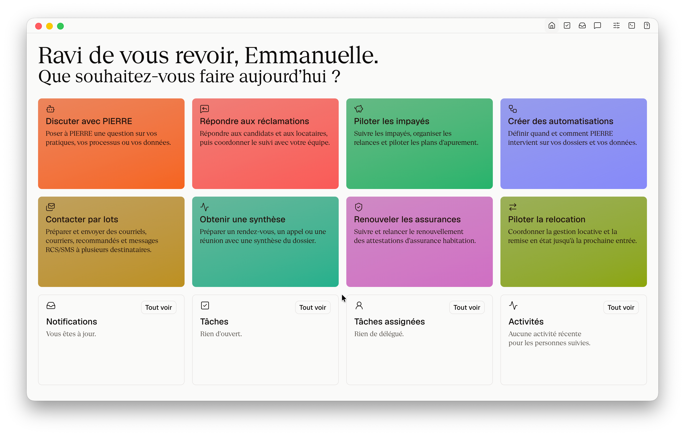

# PIERRE

#### 🚧 — PIERRE n'est PAS production-ready ; il le sera dans quelques semaines.

## Tous les métiers HLM réunis dans une application IA-First, open code et gratuite.

PIERRE réunit les équipes HLM au sein d'une même expérience utilisateur et met l’intelligence artificielle au coeur de leur travail. Proposée en **open code**, l'application est auditable, **auto-hébergeable** et **gratuite** pour les bailleurs sociaux.

1. **Une expérience commune à tous les métiers HLM** : réclamations, impayés, relocation, assurance habitation… Les mêmes repères d’un métier à l’autre et une continuité entre les processus et les équipes. Moins de frictions et de ruptures, davantage de capacité d’action et de performance opérationnelle au quotidien.

2. **L’IA au coeur du travail, pas greffée sur les logiciels historiques** : votre agent comprend les dossiers, prépare les décisions et les communications, exécute les tâches répétitives et mobilise les bonnes personnes au bon moment sur la base de **vos** processus. PIERRE fait travailler les humains et l’IA côte à côte.

3. **Trois socles mutualisés pour inventer et construire l’IA HLM** : [Core Data HLM](./02-core-data-hlm/index.md) donne aux données un langage commun pour les humains et les machines. [Core Models HLM](./03-core-models-hlm/index.md) propose des modèles de langage ouverts, compacts et hyper-spécialisés. **Core Intelligence HLM** mutualise les connaissances métier, les instructions et les capacités d’action.

4. **L'évident intégré nativement** : collaboration, notifications, mentions, SMS/RCS, emails, courriers postaux (avec ou sans recommandé) et signature électronique.

5. **Un actif commun et souverain pour le mouvement HLM** : chaque bailleur garde la maîtrise de ses données, de son hébergement et du modèle d’IA qu’il utilise. Les organismes peuvent enrichir ensemble l'application et transformer leurs contributions locales en progrès collectif.

## Construire un « commun numérique » pour le mouvement HLM

### 300 M€/an. Depuis plus de vingt ans

Le mouvement HLM consacre chaque année près de **300 millions d’euros** à ses applications métier. Sur vingt ans : [6 milliards](./07-articles/2026-08-19-300M€Y-for-IT.md).

Le problème n'est pas tant le montant que ce qu'en obtient en échange le mouvement. Nul ne s'en satisfait, malgré l'engagement de ceux qui ont porté ces systèmes. Ni les locataires, ni les collaborateurs, ni les directions informatiques, ni les directions générales.

Les progrès de l’intelligence artificielle rendent aujourd’hui possible une nouvelle génération de logiciels HLM. Le principal enjeu devient collectif : organiser et conduire cette transformation.

### On ne greffe pas l’IA sur les logiciels d’hier

Au fil des décennies, **les logiciels HLM historiques ont trop accumulé**. Trop d'interfaces, trop de dette technique, trop de code spaghetti, trop de roadmap qui s'étirent à l'infini. Cette accumulation frustre les utilisateurs, complexifie les processus, introduit des lenteurs et progressivement, mais sûrement, fait diverger les outils des pratiques du quotidien.

À l'image d'un directeur général HLM qui oublierait ce qu’est le métier de gardien, les éditeurs logiciels ont oublié le terrain.

Introduire l’IA dans les processus HLM ne consiste pas à superposer un chatbot à des logiciels inchangés. **Il faut réinventer le logiciel lui-même**, ainsi que la structure des données sur lesquelles il repose.

PIERRE est un **applicatif « User-First × IA-First »** : l’intelligence artificielle n’est utile que lorsqu’elle simplifie concrètement le travail et renforce la capacité d’action des équipes. Son principe : « **Human + IA : side-by-side** ».

### Pas de données métier, pas d’IA métier

Sans données structurées et à jour, pas de systèmes agentiques capables d'interpréter les données et les dossiers. Sans données réelles, pas de modèles de langage spécialisés. **L’IA HLM ne se décrète pas : elle s'invente et se construit**.

[Core Data HLM](./02-core-data-hlm/index.md) définit un référentiel de données minimal, robuste et intelligible par les humains comme par les machines. Il permet aux systèmes agentiques d’interpréter les données et les dossiers, et démultiplie les usages utiles aux équipes.

Au sein de [Core Models HLM](./03-core-models-hlm/index.md), [CARL](./03-core-models-hlm/CARL.md) est le **premier modèle de langage entrainé spécifiquement pour le mouvement HLM** : hyper-spécialisé, compact, frugal, souverain et open-weight, il qualifie en 50 millisecondes les messages des candidats et locataires.

### Le mouvement HLM n’a pas les contraintes de Wall Street

À l’échelle du mouvement, les volumes se comptent en millions (de logements, de réclamations, de bons de commande et de quittances). Le « temps réel », quant à lui, s'apprécie et se mesure en minutes, non en millisecondes. Divisée par le nombre de bailleurs, cette échelle est — quoi qu'en dise le gotha HLM informatique — anecdotique.

Dans ce contexte, une architecture simple n’est pas un manque d’ambition. C’est un choix d’ingénierie : privilégier la robustesse et la sobriété plutôt qu'une complexité inutile et datée. Ce parti pris est exposé dans « [SQLite et un harnais suffisent pour le logement social français](./07-articles/2026-05-27-rag-sqlite.md) » (article en anglais).

**La simplicité ne se fait pas au détriment de la sécurité**. PIERRE propose nativement une approche BYOK (« Bring Your Own Key ») : chaque bailleur choisit son modèle d’IA, maîtrise ses clés et détermine les conditions d’utilisation. Les traitements agentiques s’exécutent dans des environnements confinés avec une isolation matérielle stricte. Auto-hébergeable, vos données sont à Paris, à Dijon ou autre part, à votre discrétion. Auditable, vous pouvez challenger l'implémentation.

Cette architecture a fait l’objet d’une analyse d’impact relative à la protection des données (AIPD) conduite avec [Grand Dijon Habitat](http://granddijonhabitat.fr). Souveraineté et sécurité des données _by design_.

### Le logiciel comme actif commun

Le modèle historique des logiciels HLM repose sur des licences onéreuses, des projets d’intégration coûteux et une forte dépendance à l’éditeur. **PIERRE propose une orthogonale**.

**PIERRE est disponible en open code** : son code est accessible, auditable et auto-hébergeable. Tous les bailleurs sociaux peuvent le télécharger, l’installer et l’utiliser **gratuitement** pour leurs propres besoins (sans licence ni coût par utilisateur), et suggérer des améliorations qui profitent à l'ensemble du mouvement.

Son **modèle économique** repose sur les contributions libres des bailleurs sociaux, dans l’esprit de très nombreux projets open source. Sa **gouvernance** reste à inventer à l'intersection de l’USH, des fédérations, des bailleurs et de leurs besoins.

Depuis 1853, le mouvement HLM construit des communs immobiliers. Il peut désormais construire ses communs numériques. Le logiciel devient ainsi un actif plutôt qu’une dépendance. PIERRE entend constituer cette première brique de **souveraineté numérique** du mouvement HLM. Parce que l’époque est au _build_.

## Rejoindre la co-construction

Un commun ne vaut que par ceux qui s’en emparent. Un nouvel outil demande toujours un effort. En utiliser une vingtaine, sans cohérence d’interface ni continuité entre les processus, en demande davantage encore, chaque jour.

PIERRE réduit les obstacles à l’adoption en proposant une expérience utilisateur cohérente pour l’ensemble des métiers. Mais un outil ne transforme pas à lui seul les pratiques : l’implication des équipes, l’exemplarité du management, la formation et l’accompagnement du changement restent essentiels.

PIERRE se construit actuellement avec [Grand Dijon Habitat](http://granddijonhabitat.fr). Les organismes qui souhaitent contribuer à ce commun numérique et en développer les usages sont invités à rejoindre la co-construction.

## Installer

#### 🚧 — PIERRE n'est PAS production-ready ; il le sera dans quelques semaines.

PIERRE est conçu pour une mise en œuvre progressive, sans projet d'intégration de plusieurs mois. En autonomie, les ordres de grandeur sont les suivants :

- **Installation + déploiement** : une à deux heures pour une DSI normalement à l'aise avec un serveur Linux, ses DNS et sa solution de gestion de parc (MDM/UEM).
- **Paramétrage des modules** : de quelques minutes à quelques heures avec le métier, selon le degré de personnalisation.
- **Génération des données issues de Core Data HLM** : de quelques heures à quelques jours selon l'aisance avec laquelle la DSI sait manipuler ses données.
- **Prise en main** : PIERRE est pensé pour le métier, la prise en main est simple.

### Liens utiles

- [Code source](https://github.com/charnould/pierre)
- [Documentation](https://github.com/charnould/pierre/blob/master/docs/06-installation/index.md) (_en cours_)
- [Core Data HLM](./02-core-data-hlm/index.md) (_en cours_)
- [Core Models HLM](./03-core-models-hlm/index.md)

Nous pouvons vous accompagner à chaque étape : démonstration, cadrage, hébergement, déploiement, paramétrage, formation des équipes. [charnould@pierre-ia.org](mailto:charnould@pierre-ia.org)

## Licence

Un bailleur social peut utiliser PIERRE gratuitement pour son activité. Pour les autres cas d’usage, les conditions sont exposées dans la [licence](https://github.com/charnould/pierre/blob/master/LICENSE.md). Core Data HLM, Core Intelligence HLM, la taxonomie de CARL et la documentation sont sous licence [CC BY-SA 4.0](https://creativecommons.org/licenses/by-sa/4.0/deed.fr). Les bibliothèques et ressources tierces restent sous leur licence propre.

Copyright © 2024-aujourd’hui · [Charles-Henri Arnould](mailto:charnould@pierre-ia.org) / BECKREL SAS et les contributeurs.
